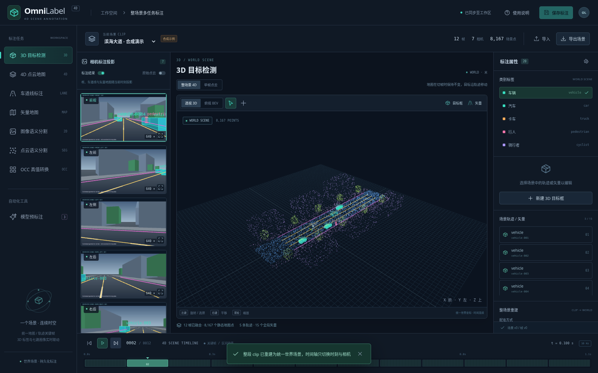

# OmniLabel

面向自动驾驶 clip 的多传感器、多任务标注工作台。React / TypeScript / Three.js
前端与 FastAPI / NumPy 后端共享一套标定、坐标和标注格式，支持 7 路环视图像与激光点云。

平台使用 clip 级的 **4D 整场景工作区**，默认提供**合成数据**供操作和几何验证。
真实数据通过 JSON / ZIP 导入，不需要外部云账号。当前面向可信的单用户环境；
未提供登录、租户隔离或生产级权限管理，请在本机或受控内网使用。



## 启动

需要 Python 3.12+、Node.js 22+ 和支持 WebGL 的现代浏览器。

```bash
cd /workspace/OmniLabel
bash scripts/setup.sh
bash scripts/serve.sh
```

`setup.sh` 安装锁定的前后端依赖、构建前端并运行后端测试。
`serve.sh` 用同一个 8000 端口提供前端和 API，默认仅监听本机。
可信网络部署可设置 `OMNILABEL_HOST=0.0.0.0`；端口通过
`OMNILABEL_PORT` 配置。数据保存在被 Git 忽略的 `data/`，可通过
`OMNILABEL_DATA_DIR` 指定其他目录。程序首次启动生成演示 clip，之后保留用户标注。

开发时分别运行：

```bash
PYTHONPATH=backend .venv/bin/python -m uvicorn omnilabel.main:app --reload
npm run dev
```

Vite 将 `/api` 请求代理到后端的 8000 端口。

## 标注流程

1. 选择示例 clip 或导入 clip JSON / ZIP，检查相机内参、外参和每帧位姿。
2. 导入后自动把整个 clip 重建为世界坐标地图；需要修正配准时选择 ICP 重建。时间轴切换相机和目标轨迹，地图保持不变。
3. 创建目标轨迹和全局矢量；选中框后用控制柄拖动平移、六面缩放或航向旋转。在任一时刻编辑动态目标会建立关键帧。
4. 左侧滚动相机栏实时显示框、车道线和地图标注投影。像素和点级任务可切到源帧；模型候选审核后应用并保存。
5. 导出 clip 标注及派生数据供审核或下游训练使用。

| 任务 | 当前能力 | 数据前提与范围 |
| --- | --- | --- |
| 3D / 4D 目标标注 | 框创建、拖动平移/缩放/旋转、跨时刻轨迹、关键帧和插值 | 静态世界状态或动态时间关键帧；不声称自动估计真实运动 |
| 4D 点云地图 | 全 clip 重建、位姿融合 / 实际 ICP、动态目标过滤、持久世界场景与轨迹 | ICP 需要重叠与有效几何；没有回环或全局 SLAM 优化 |
| 车道线 | BEV / 3D 视图折线标注 | 在地面平面绘制，非平路可修改导入后的三维坐标 |
| 矢量地图 | 世界坐标共享折线、多边形和类别；左侧相机同步投影 | 世界→活动 LiDAR 使用重建后的实际配准变换 |
| 图像语义分割 | 人工多边形、SAM2 正点/负点/框提示候选、掩码导出 | SAM2 需要远程模型配置与权重；类别由人工指定 |
| 点云语义分割 | 点选择 / 笔刷赋类与 CPU 地面候选 | 标签保持原点索引；地面候选需要审核 |
| OCC | CPU 观测占用/自由转换，或 OpenOccupancy 真实模型语义占用候选 | 两者分开标记来源；模型预测需人工审核，未返回区域保持 unknown |
| 标注结果投影 | 3D 框、车道线、矢量地图和图像区域实时投影；原始点云是可选图层 | 支持外参链、Brown 畸变、近面/画幅裁剪；已去畸变图像使用新 K 与零畸变 |

所有模型生成标注和几何候选都应经人工审核才能作为训练真值。
仓库已包含 SAM2、MMDetection3D、OpenOccupancy 的实际官方 API 推理适配器和部署脚本，
主平台不捆绑 GPU 运行时或权重。通过模型面板分别配置远程服务并检查真实加载状态；
协议、独立运行环境和 7 路相机适配限制见[模型接入说明](docs/model-worker.md)。
当前远程服务地址尚未提供，真实 checkpoint 推理仍需在目标 GPU 环境验收。
候选结果需要明确应用并另行保存，生成候选不会覆盖人工标注。

## 数据格式与算法约定

- [数据导入说明](docs/data-format.md)：clip 格式、标定约定、图像与点云文件格式。
- [接口契约](docs/contract.md)：前后端数据结构和 API。
- [开源参考与模型接入方向](docs/references.md)：参考项目、许可证与真值审核要求。
- [模型服务接入](docs/model-worker.md)：真实图像、点云与标定的推理协议和候选审核。
- [4D 整场景说明](docs/4d-scene.md)：世界坐标标注、关键帧、ICP 诊断及配准后的导入导出。

统一使用米、秒和弧度，右手 LiDAR / ego 坐标为 x 前、y 左、z 上；
相机光学坐标为 x 右、y 下、z 前。外参矩阵采用列向量。
投影变换为 `camera_from_ego @ lidar_to_ego @ p_lidar`，
地图变换为 `ego_to_world @ lidar_to_ego @ p_lidar`。

## 验证

```bash
PYTHONPATH=backend .venv/bin/python -m pytest
npm run build
npm run test:e2e
```

浏览器测试使用系统 Chromium；可用 `CHROMIUM_PATH` 指向已安装的可执行文件。
测试会在独立临时目录启动后端，不覆盖实际标注数据。

## 后续生产化

实际生产部署还需要：真实传感器样例验收、相机与激光雷达的时间同步策略、
百万点流式分块、多用户鉴权和审核流、对象存储、异步 GPU 队列、
模型版本与推理来源追溯、数据集导出适配器，以及备份和运行监控。
本仓库当前实现不将这些能力伪装成已部署服务。

MIT 许可证适用于本仓库原创代码。参考项目及模型权重各自遵循其许可证；
本实现未复制参考项目代码或捆绑权重。
